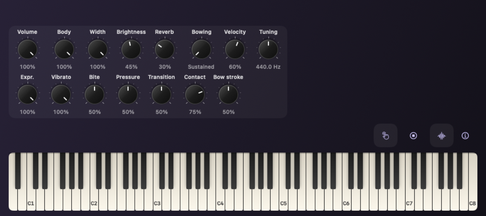
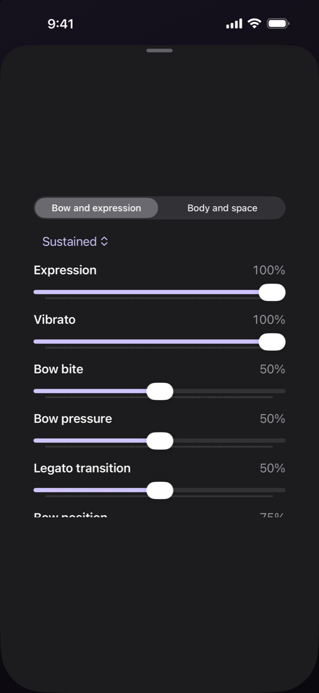

# Strings

English · [日本語](README.md) · [简体中文](README.zh-Hans.md)

Strings is a sample-free string instrument for macOS, iPhone, and iPad. It runs as a standalone SwiftUI app or as an AUv3 instrument in compatible DAWs. The Rust engine supports 32 voices and four articulations. The interface is available in English, Japanese, and Simplified Chinese.

The [audio demo](docs/strings-demo.wav) plays bowed chords, pizzicato, legato, changes in bow position, and spiccato at different velocities.

## Screenshots

| macOS | iPhone 16 Pro Max |
| --- | --- |
|  |  |

## Build

Strings targets macOS 15 and iOS or iPadOS 18 or later. Install Xcode and Rust through rustup.

1. Open `Strings.xcodeproj`. Choose **Strings-macOS** for Mac or **Strings** for iPhone and iPad.
2. On Apple silicon, run `rustup target add aarch64-apple-ios aarch64-apple-ios-sim` for iOS builds. On Intel, run `rustup target add x86_64-apple-darwin x86_64-apple-ios`.
3. For a physical iPhone or iPad, select your development team for both the app and the AUv3 extension in **Signing & Capabilities**.

After editing `project.yml`, run `xcodegen generate` to update the Xcode project.

## Play

Mac displays the full 88-key range from A0 to C8. Drag a knob up or down to adjust its value. Double-click to restore its default. You can resize the window horizontally. On iPhone and iPad, tap the octave arrows to change the keyboard range. Use the sound controls to adjust tone and articulation.

- **Sustained** supports bowed chords. **Legato** uses a single bowed voice. Overlap two keys to connect them without restarting the attack. Release the newer key to return to the previous one if it is still held.
- **Spiccato** simulates a short bow bounce. Higher velocity gives a sharper attack and a slightly longer note. The hand button switches to **Pizzicato**.
- **Bow position** moves the string contact point from fingerboard to bridge. **Bow stroke** adjusts the position from frog to tip. Controls also include expression, vibrato depth, bow bite, bow pressure, legato transition time, body resonance, ensemble width, brightness, reverb, master volume, and A4 tuning from 430–450 Hz.
- Turn off sustain to release the note when you let go of the key. Use the stop button or **Esc** on Mac to clear notes, sustain, and reverb output.

### MIDI and AUv3

| MIDI | Action |
| --- | --- |
| Note On / Off | A0–C8, with velocity |
| CC11 | Expression, including held notes |
| CC64 | Sustain |
| CC67 | Pizzicato |
| CC120 / CC123 | Stop all sound and clear sustain |

The standalone app detects connected CoreMIDI sources. In an AUv3-compatible DAW, choose **Strings: Bowed Ensemble**. AUv3 supports mono or stereo output from 44.1–96 kHz. Spiccato takes precedence when both its parameter and Legato are enabled. After registration, validate the extension on Mac with `auval -v aumu ST01 LStr`.

## Roadmap

- 🟢 [Done] Four articulations, performance and tone controls, MIDI, and AUv3
- 🟢 [Done] English, Japanese, and Simplified Chinese interface
- ⭕️ [Pending] Physical-device latency measurements and testing with external MIDI hardware and DAWs
