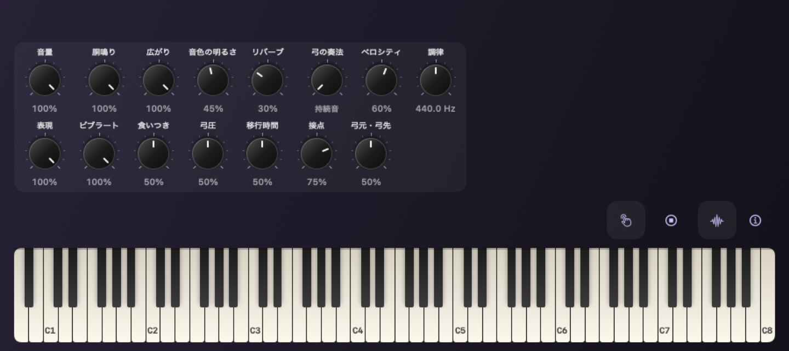
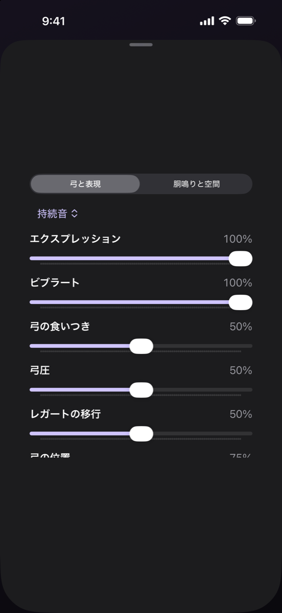

# Strings

[English](README.en.md) · 日本語 · [简体中文](README.zh-Hans.md)

Piano と同じ SwiftUI・Rust・AUv3 構成で作ったストリングス音源です。macOS、iPhone、iPad で単体起動でき、対応する DAW では AUv3 として使えます。画面は英語、日本語、简体中文に対応します。

[試聴用 WAV](docs/strings-demo.wav) は、弓弾きのコード、ピチカートのアルペジオ、レガートの旋律、弓の位置の変化、ベロシティを変えたスピッカートを順に収録しています。

## スクリーンショット

| macOS | iPhone 16 Pro Max |
| --- | --- |
|  |  |

## ビルド

macOS 15 または iOS・iPadOS 18 以降が対象です。ビルドには Xcode と Rust（rustup）が必要です。

1. `Strings.xcodeproj` を開きます。Mac では **Strings-macOS**、iPhone・iPad では **Strings** スキームを選びます。
2. Apple シリコン Mac の iOS ビルド用には `rustup target add aarch64-apple-ios aarch64-apple-ios-sim` を実行します。Intel Mac では `rustup target add x86_64-apple-darwin x86_64-apple-ios` を実行します。
3. iPhone・iPad の実機では、アプリと AUv3 拡張の両方で **Signing & Capabilities** の開発チームを指定します。

`project.yml` を変更した場合は、XcodeGen の `xcodegen generate` で Xcode プロジェクトを更新できます。

## 演奏

Mac では A0〜C8 の88鍵をミニ鍵盤で表示します。Mac の操作パラメーターは鍵盤上の2段のノブに並びます。上下ドラッグで調整し、ダブルクリックで初期値に戻せます。ウインドウは横幅を変えられます。iPhone・iPad では鍵盤の矢印で表示音域を切り替えられます。iPhone と iPad ではマルチタッチで和音を弾けます。手のアイコンで、次に鳴らす音からピチカートに切り替えます。iPhone・iPad ではスライダーアイコンから明るさとルームリバーブを調整できます。

**弓の奏法** で **レガート** を選び、前の鍵盤を離す前に次の鍵盤を押すと、弓を引き直さずに音程が移ります。最後に押した音が優先され、その鍵盤を離すと押したままの前の音に戻ります。レガート時の弓弾きは単音で、和音を弾く場合は **持続音** または **スピッカート** を選びます。

**スピッカート** は弓が弦に短く触れたあと自然に減衰します。弱いベロシティでは柔らかく短く、強いベロシティではアタックがはっきりして少し長く鳴ります。

**弓の位置** は指板側（0%）から駒側（100%）まで調整でき、発音中の倍音構成にも反映されます。

### 音色調整

- **弓と表現** ではエクスプレッション、ビブラートの深さ、弓の食いつき、弓圧、レガートの移行時間、弦上の接点、弓元・弓先の位置を調整できます。弓元・弓先は摩擦音と倍音の出方を変えます。レガートの移行時間は 4〜52 ms です。
- **胴鳴りと空間** では胴鳴り、アンサンブルの広がり、音色の明るさ、リバーブ、全体音量、基準ピッチを調整できます。広がりは奏者間のピッチ差とステレオ定位に作用し、基準ピッチは A4 を 430〜450 Hz の範囲で調整します。
- エクスプレッションは MIDI CC11 と掛け合わせて発音に反映されます。全体音量はリバーブを含む最終出力を調整します。単体アプリの調整値は再起動時にも復元されます。

音が鳴り続けるときは、鍵盤上の停止ボタン（Mac では Esc キーも可）で発音とリバーブを止め、サステインを解除できます。

単体アプリは接続済みの CoreMIDI 入力を検出します。単体アプリと AUv3 が受け付ける演奏操作は以下のとおりです。

| MIDI | 操作 |
| --- | --- |
| Note On / Off | A0–C8、ベロシティ対応 |
| CC11 | 鳴っている音も含めてエクスプレッションを調整 |
| CC64 | サステインをオン・オフ |
| CC67 | ピチカートをオン・オフ |
| CC120 / CC123 | すべての発音とリバーブを停止し、サステインを解除 |

AUv3 の表示名は **Strings: Bowed Ensemble** です。モノまたはステレオの 44.1–96 kHz 出力と、音色調整パネルのパラメーターと、レガート・スピッカートの切り替えを備えます。AUv3 で両方の奏法パラメータを有効にすると、スピッカートが優先されます。Mac ではアプリを起動してから、AUv3 対応 DAW のインストゥルメント一覧で選びます。登録後は `auval -v aumu ST01 LStr` で検証できます。

## 音源

録音素材を使わない加算合成です。弓弾きは、発音のタイミング、ピッチ、ビブラート、定位が少しずつ異なる 3 系統を重ねます。発音直後は弓の摩擦音が目立ち、ベロシティで立ち上がりと倍音構成が変わります。CC11 は弓弾きの音量と明るさを連動して変化させます。

ピチカートは発音ごとに撥弦位置をわずかに変え、高域が低域より先に減衰するようにしています。左右それぞれの共鳴フィルタで楽器の胴鳴りを近似しています。各共鳴の周波数と強さは手作業で設定した値です。

サステインがオフの場合、弓弾きもピチカートも鍵盤を離すと短くフェードします。リバーブの余韻は設定に応じて残ります。最大同時発音数は 32 です。

## ロードマップ

- 🟢 [Done] 弓弾き、ピチカート、明るさ、ルームリバーブ、MIDI エクスプレッション
- 🟢 [Done] macOS・iOS・iPadOS アプリ、AUv3、3 言語の画面表示
- 🟢 [Done] 弓弾きのレガート、弓の位置の連続調整
- 🟢 [Done] ベロシティでアタックと長さが変わるスピッカート
- 🟢 [Done] 弓と表現、胴鳴りと空間の音色パラメーター
- ⭕️ [Pending] 実機での発音レイテンシー、外部 MIDI 機器と DAW での試奏
