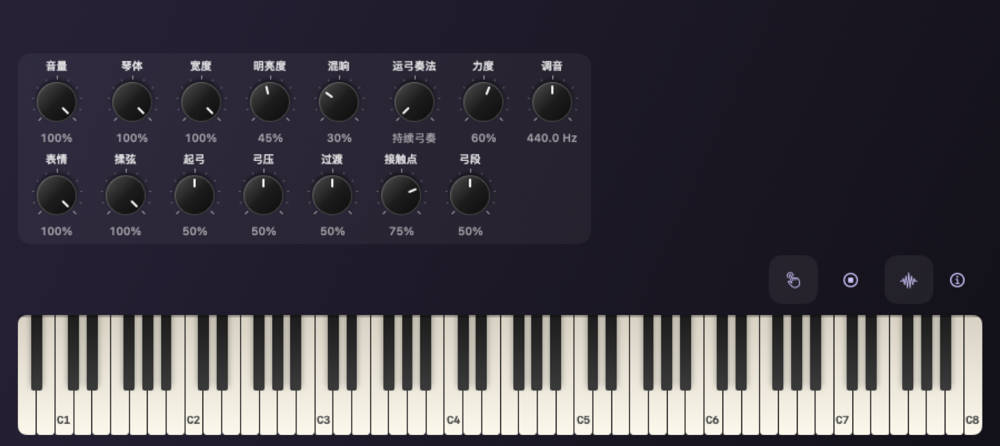
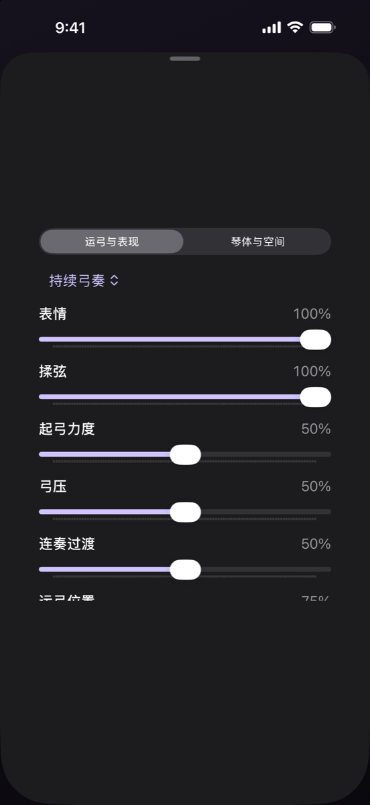

# Strings

[English](README.en.md) · [日本語](README.md) · 简体中文

Strings 是一款适用于 macOS、iPhone 和 iPad 的弦乐音源。它既能作为独立的 SwiftUI 应用运行，也能在兼容的 DAW 中作为 AUv3 乐器使用。Rust 合成引擎无需录音采样，支持 32 音复音和四种奏法。界面支持英语、日语和简体中文。

[音频示例](docs/strings-demo.wav) 依次展示弓奏和弦、拨奏、连奏、弓弦接触点的变化，以及不同力度的跳弓。

## 截图

| macOS | iPhone 16 Pro Max |
| --- | --- |
|  |  |

## 构建

系统要求为 macOS 15 或 iOS、iPadOS 18 及以上。请安装 Xcode，并通过 rustup 安装 Rust。

1. 打开 `Strings.xcodeproj`。在 Mac 上选择 **Strings-macOS**，在 iPhone 或 iPad 上选择 **Strings**。
2. 在 Apple 芯片的 Mac 上构建 iOS 版时，运行 `rustup target add aarch64-apple-ios aarch64-apple-ios-sim`。在 Intel Mac 上运行 `rustup target add x86_64-apple-darwin x86_64-apple-ios`。
3. 在 iPhone 或 iPad 真机运行前，分别在应用和 AUv3 扩展的 **Signing & Capabilities** 中选择开发团队。

修改 `project.yml` 后，可以运行 `xcodegen generate` 更新 Xcode 工程。

## 演奏

Mac 版同时显示 A0 至 C8 的全部 88 键。上下拖动旋钮可调节参数，双击可恢复默认值。窗口宽度可调。在 iPhone 和 iPad 上，可用箭头切换琴键音域，通过音色设置调整音色和奏法。

- **持续弓奏**支持和弦。**连奏**使用单声部弓奏。松开前一个琴键前先按下下一个琴键，音高就会衔接而无需重新起弓。若前一个键仍按住，松开后一个键时会返回前一个音。
- **跳弓**模拟弓短暂触弦后弹起的声音。力度越强，起音越清晰，音也会稍长。手形按钮可切换到**拨奏**。
- **运弓位置**控制弦上的接触点，范围从指板侧到琴码侧。**弓段位置**控制弓根到弓尖的位置。其他参数包括表情、揉弦深度、起弓力度、弓压、连奏过渡时间、琴体共鸣、合奏宽度、明亮度、混响、主音量及 430–450 Hz 的 A4 基准音高。
- 关闭延音后，松键即可让该音释放。停止按钮可清除发音、延音和混响，Mac 上也可按 **Esc**。

### MIDI 与 AUv3

| MIDI | 操作 |
| --- | --- |
| Note On / Off | A0–C8，支持力度 |
| CC11 | 表情，包括正在发声的音符 |
| CC64 | 延音开关 |
| CC67 | 拨奏开关 |
| CC120 / CC123 | 停止所有声音并清除延音 |

独立应用会检测已连接的 CoreMIDI 输入。在兼容 AUv3 的 DAW 中选择 **Strings: Bowed Ensemble**。扩展支持 44.1–96 kHz 的单声道或立体声输出。同时开启连奏与跳弓参数时，跳弓优先。在 Mac 上注册扩展后，可运行 `auval -v aumu ST01 LStr` 进行验证。

## 路线图

- 🟢 [Done] 四种奏法、演奏与音色参数、MIDI 和 AUv3
- 🟢 [Done] 英语、日语和简体中文界面
- ⭕️ [Pending] 真机延迟测量、外接 MIDI 设备及 DAW 测试
